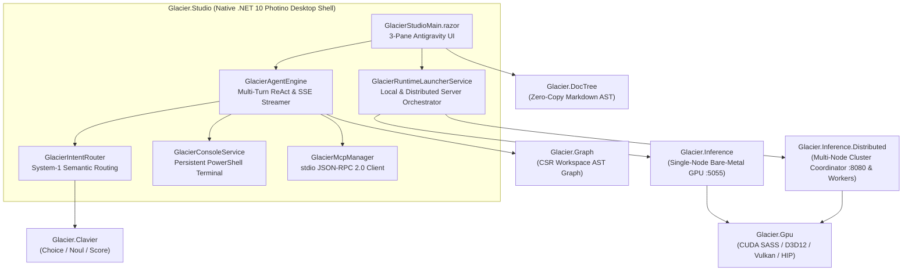

# ❄️ Glacier.Studio

### Pure C# .NET 10 Autonomous Desktop AI Agent IDE & Distributed Cluster Cockpit

[](LICENSE)
[](https://dotnet.microsoft.com/)
[](https://www.tryphotino.io/)
[](https://github.com/ian-cowley)
[](https://github.com/ian-cowley/Glacier.Studio/actions/workflows/release.yml)
[]()

```text
========================================================================================================
  GLACIER.STUDIO: PURE C# .NET 10 AUTONOMOUS DESKTOP AGENT COCKPIT (ANTIGRAVITY 2 ARCHITECTURE)
========================================================================================================
  Decision & Routing Engine :  Glacier.Clavier System-1 discrete semantic prototype scoring (< 0.15 ms)
  Workspace Symbol Index    :  Glacier.Graph in-process Forward-Star CSR AST & dependency graph
  Document AST Engine       :  Glacier.DocTree zero-copy ReadOnlySpan<char> parser & outline navigator
  Single-Node GPU Runtime   :  Glacier.Inference bare-metal NVIDIA SASS / D3D12 Wave32 / Vulkan / AVX-512
  Multi-Node Cluster Runtime:  Glacier.Inference.Distributed pipeline & tensor cluster orchestrator
  Protocol & Tooling Bus    :  OpenAI/Ollama SSE Streaming + JSON-RPC 2.0 stdio Model Context Protocol
========================================================================================================
```

---

## 1. Overview

**`Glacier.Studio`** is a standalone native desktop agentic coding and local LLM mission-control environment built in pure C# on **.NET 10** and **Photino Native WebView**. Modeled on the Google Antigravity 2.0 multi-pane workflow, it unifies conversational ReAct agent execution, real-time PowerShell command execution, in-process workspace AST knowledge graph inspection, zero-copy document outline navigation, Model Context Protocol (MCP) stdio servers, and turnkey orchestration of both single-node and multi-node distributed GPU inference servers.

```text
┌─────────────────────────┬───────────────────────────────────┬──────────────────────────────────────────┐
│  1. THREADS & SESSIONS  │     2. AGENT & CHAT CANVAS        │     3. INSPECTOR & RUNTIME DRAWER        │
├─────────────────────────┼───────────────────────────────────┼──────────────────────────────────────────┤
│ • [+ New Thread]        │ • Live SSE Token-by-Token Stream  │ 📄 Document (Glacier.DocTree AST)        │
│ • Instant Thread Filter │ • Collapsible <think> Reasoning   │    • 1-Based Source Line Click-to-Scroll │
│ • Disk Persistence      │ • Clavier Execution Plan Cards    │    • Live Word & Token Budget Counters   │
│   (.glacier/studio/)    │ • Expandable Tool Call Telemetry  │ 💻 Terminal (Shared PowerShell Session)  │
│ • Export (.md / .json)  │ • Live 3-Dot Wave & 100ms Timer   │    • Persistent Working Directory        │
│ • Multi-Provider Hub:   │ • Full Autonomous Tooling:        │    • ANSI Color Parser & Process Tree    │
│   - Glacier.Inference   │   - run_command (PowerShell CLI)  │ 🕸️ Graph (Glacier.Graph CSR Index)       │
│   - Glacier.Distributed │   - read_file / write_file        │    • Live Symbol & Project Neighborhoods │
│   - Local Ollama        │   - search_files / list_dir       │ ⚡ System & Local Inference Runtimes     │
│   - Local LM Studio     │   - query_workspace_graph         │    • 1-Click Glacier.Inference (:5055)   │
│   - Cloud Gemini / OAI  │   - stdio MCP Server Tools        │    • Multi-Node Distributed Cluster UI   │
└─────────────────────────┴───────────────────────────────────┴──────────────────────────────────────────┘
```

---

## 2. The Glacier Ecosystem Repositories That Power `Glacier.Studio`

`Glacier.Studio` is the flagship desktop cockpit that brings together the core libraries of the **[Glacier .NET 10 High-Performance Ecosystem](https://github.com/ian-cowley)** into a single unified process:

| Repository | Role Inside `Glacier.Studio` | Key Architectural Capabilities |
| :--- | :--- | :--- |
| **[`Glacier.Inference`](https://github.com/ian-cowley/Glacier.Inference)** | **Single-Node Bare-Metal GPU & SIMD Inference Runtime** | Provides hardware discovery (`DeviceManager`), GGUF weight inspection, and the local `:5055` inference server executing Meta Llama 3, Alibaba Qwen 2.5/3/3.5, DeepSeek-R1, Microsoft Phi-4, and Google Gemma 4 via direct NVIDIA SASS (`nvcuda.dll`), AMD HIP, Direct3D 12 Wave32, Vulkan SPIR-V, and AVX-512 SIMD with zero C++ dependencies. |
| **[`Glacier.Inference.Distributed`](https://github.com/ian-cowley/Glacier.Inference.Distributed)** | **Multi-Node Pipeline & Tensor Cluster Runtime** | Powers the **Distributed Cluster Launcher** (`:8080` Coordinator & `:5056` Worker nodes). Partitions massive GGUF models across heterogeneous LAN machines using VRAM-weighted auto-allocation (`--layers auto`), 64-byte aligned socket framing over `System.IO.Pipelines`, and live `/v1/cluster/status` stage topology telemetry. |
| **[`Glacier.Clavier`](https://github.com/ian-cowley/Glacier.Clavier)** | **System-1 Discrete Decision & Policy Engine** | Drives [`GlacierIntentRouter`](src/Glacier.Studio/Services/GlacierStudio/GlacierIntentRouter.cs) in sub-millisecond forward passes (`Choice`, `Noul`, `Score`). Performs semantic prototype scoring to classify developer intent without brittle regex keyword lists, formulates strategic execution plans, and supervises multi-step ReAct turns. |
| **[`Glacier.Graph`](https://github.com/ian-cowley/Glacier.Graph)** | **In-Process Forward-Star CSR Knowledge Graph** | Powers [`GlacierWorkspaceGraphService`](src/Glacier.Studio/Services/GlacierStudio/GlacierWorkspaceGraphService.cs) and the **Graph** inspector tab. Indexes `.csproj` dependencies, C# namespaces, classes, structs, interfaces, and methods into a zero-allocation array-backed CSR graph for instant $O(1)$ neighborhood lookups (`query_workspace_graph`). |
| **[`Glacier.DocTree`](https://github.com/ian-cowley/Glacier.DocTree)** | **Zero-Copy Markdown & Source AST Parser** | Powers [`GlacierDocTreePreviewService`](src/Glacier.Studio/Services/GlacierStudio/GlacierDocTreePreviewService.cs) and the **Document** tab. Parses markdown and source files using `ReadOnlySpan<char>` slicing to generate hierarchical document outlines with 1-based line numbers and click-to-scroll navigation. |
| **[`Glacier.Gpu`](https://github.com/ian-cowley/Glacier.Gpu)** | **Heterogeneous Bare-Metal GPU Compute HAL** | Supplies low-level hardware enumeration, VRAM/shared memory telemetry, and direct driver P/Invoke bindings across NVIDIA CUDA, AMD ROCm/HIP Unified APU memory, and Direct3D 12. |
| **[`Glacier.Vector`](https://github.com/ian-cowley/Glacier.Vector)** | **SIMD-Accelerated Vector Search & Embeddings** | Provides AVX-512 / AVX2 cosine similarity and semantic vector indexing for context retrieval and local MCP vector stores (`GlacierVectorEngine`). |
| **[`Glacier.Polaris`](https://github.com/ian-cowley/Glacier.Polaris)** | **Columnar Arrow DataFrame & Query Engine** | Provides high-throughput columnar memory containers and SIMD compute primitives for structured telemetry and analytical tool outputs. |
| **[`Glacier.Cluster`](https://github.com/ian-cowley/Glacier.Cluster)** | **Distributed Compute Fabric & Collective Engine** | Provides the underlying distributed transport framing, node health heartbeats, and ring collective primitives used across the Glacier cluster stack. |
| **[`Glacier.Showcase`](https://github.com/ian-cowley/Glacier.Showcase)** | **Web-Based Visual Mission Control** | Sister Blazor web dashboard complementing the standalone Photino desktop experience in `Glacier.Studio`. |



---

## 3. Key Features

### 🧠 1. Autonomous ReAct Agent with `Glacier.Clavier` System-1 Routing
- **Semantic Prototype Routing (No Keyword Lists)**: [`GlacierIntentRouter`](src/Glacier.Studio/Services/GlacierStudio/GlacierIntentRouter.cs) uses `Glacier.Clavier` continuous `Score` and `Choice` primitives against semantic prototypes (`GeneralInquiry`, `ArchitectureReview`, `CodeSearch`, `ImplementationAndEdit`, `BuildAndTest`, `Debugging`, `DocumentationAndSpecs`).
- **Full Autonomous Tool Access**: The model always has access to core workspace and terminal tools—including `run_command` (PowerShell CLI), `read_file`, `write_file`, `replace_in_file`, `list_dir`, `search_files`, and `query_workspace_graph`—allowing it to autonomously decide whether to answer directly, run a system command (e.g., `Get-Date`, `dotnet test`, `git status`), inspect code, or state its limitations clearly.
- **Piecewise SSE Delta Tool Aggregator**: Streams `text/event-stream` responses token-by-token, separates `<think>...</think>` reasoning into collapsible accordions, and reassembles chunked tool call JSON arguments across SSE frames.
- **Live 3-Dot Wave & 100ms Ticking Turn Timer**: Displays a live animated status bar (`● ● ● Thinking... ⏱ 0.8s`) at the bottom of the active response card while the response is being built, transitioning into a permanent latency & throughput badge (`⏱ 0.9s · 42.1 tok/s`) upon completion.

### 🚀 2. Turnkey Local & Distributed Inference Runtime Launcher
Located in the **System** tab of the right drawer ([`GlacierRuntimeLauncherService.cs`](src/Glacier.Studio/Services/GlacierStudio/GlacierRuntimeLauncherService.cs)):
- **Automatic GGUF Model Discovery**: Scans local model directories (`D:\lmstudio\models`, `~/.lmstudio/models`, `./models`) and prioritizes models that fit cleanly in dedicated GPU VRAM for sub-second prefill.
- **Single-Node `Glacier.Inference` Card (`:5055`)**:
  - Configure **Device (`--device`)**, **Engine (`--engine`)** (`baremetal`, `cuda`, `vulkan`, `directcompute`, `cpu`), **HTTP Port (`--port`)**, and **Context Window (`--ctx`)**.
  - One-click **Start Server**, **Use Active**, and **Stop** controls with live millisecond health probes.
- **Multi-Node `Glacier.Inference.Distributed` Cluster Card (`:8080` / `:5056`)**:
  - Switch between **Coordinator (`--role coordinator`)** and **Worker Node (`--role worker`)** roles.
  - **Interactive Worker Stage Node Manager (`--stages` / `--nodes`)**: Add individual `ip:port` worker nodes (`+ Node`), remove stages with one click (`S1 127.0.0.1:5056 ✕`), or apply instant topology presets (**`Local :5056`**, **`2x Local`**, **`LAN 3-Node`**, **`Host Only`**).
  - **Full Coordinator CLI Parameters**: Configure **Layer Split (`--layers`)** (`auto` VRAM-weighted vs. explicit comma-separated counts like `8,14,6`), **Host GPU Adapter (`--host-gpu`)** (`-1` Auto Fastest VRAM or specific DX12 adapter index), **HTTP Bind Address (`--host`)**, **HTTP Port (`--http-port`)**, **Slice Cache Directory (`--cache`)**, and **Max Tokens (`--tokens`)**.
  - **Live Cluster Pipeline Topology**: Queries `GET /v1/cluster/status` when online to display each active stage's role, layer range (`L0..L13`), device name, and endpoint.
  - **Live CLI Command Preview**: Displays the exact `glacier-distributed` command line generated by your UI configuration.

### 🕸️ 3. In-Process Workspace Knowledge Graph (`Glacier.Graph`)
- Automatically scans the workspace on startup and builds an in-memory Forward-Star CSR graph of all projects, files, classes, interfaces, structs, and methods.
- Interactive filtering in the **Graph** drawer (`Workspace`, `Glacier.Gpu`, `Glacier.Clavier`, `Glacier.Inference`, etc.) with instant markdown neighborhood rendering.

### 📄 4. Zero-Copy Document Preview & AST Outline (`Glacier.DocTree`)
- Inspect any workspace Markdown or source file in the **Document** drawer.
- Displays live word count, estimated token count, interactive heading outline with 1-based line numbers, click-to-scroll navigation, and toggleable **Preview** vs. **Raw** views.

### 🛠️ 5. Native stdio Model Context Protocol (MCP) Client
- Discovers and launches configured MCP servers from `~/.gemini/config/mcp_config.json` over stdio JSON-RPC 2.0 (`GlacierMcpManager`).
- Automatically registers discovered MCP tools into the agent's dynamic toolset.

---

## 4. Installation & Quick Start

### Option 1: Download Standalone Desktop Release (Windows x64 / ARM64)
Pre-compiled standalone archives are published on the **[GitHub Releases](https://github.com/ian-cowley/Glacier.Studio/releases)** page:

| Platform | Architecture | Archive | Executable |
| :--- | :--- | :--- | :--- |
| **Windows** | `x64` | `glacier-studio-v1.0.0-win-x64.zip` | `Glacier.Studio.exe` |
| **Windows** | `ARM64` | `glacier-studio-v1.0.0-win-arm64.zip` | `Glacier.Studio.exe` |

### Option 2: Build and Run from Source (.NET 10 SDK)

```powershell
# Clone the repository
git clone https://github.com/ian-cowley/Glacier.Studio.git
cd Glacier.Studio

# Build and launch the native desktop application
dotnet run --project src/Glacier.Studio/Glacier.Studio.csproj -c Release
```

> **Note**: When cloned alongside the sister Glacier repositories in a shared parent directory, `Glacier.Studio.csproj` automatically links via live `<ProjectReference>`s; when cloned standalone, it automatically resolves the published `Glacier.*` NuGet packages.

---

## 5. Security & Zero Secrets Policy

`Glacier.Studio` enforces the **Glacier Ecosystem Zero Secrets Policy**:
- **Zero Embedded Credentials**: No API keys, tokens, or connection strings are ever written to source files, configuration files, or session exports.
- **Environment & Ephemeral Session Keys**: Cloud provider keys (`GEMINI_API_KEY`, `OPENAI_API_KEY`) are loaded strictly from OS environment variables or held exclusively in volatile UI memory for the duration of the process.

---

## Credits

Developed by Ian Cowley and Antigravity (Google DeepMind).

---

## License

Licensed under the [MIT License](LICENSE).  
Copyright (c) 2026 Ian Cowley.
