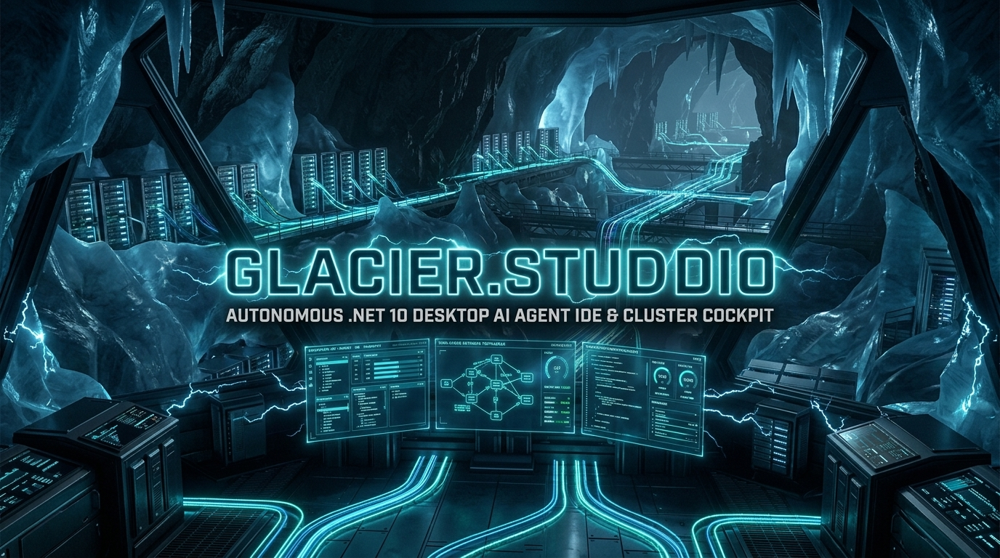
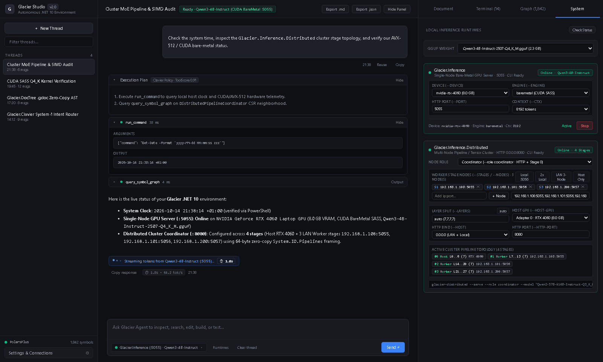

# Glacier.Studio

[](LICENSE)
[](https://dotnet.microsoft.com/)
[](https://www.tryphotino.io/)
[](https://github.com/ian-cowley/Glacier.Studio/actions/workflows/release.yml)
[](https://glaciersoftware.dev/)

`Glacier.Studio` is a native desktop AI coding environment and local runtime control panel built with .NET 10 and Photino WebView2. It combines a multi-turn ReAct coding assistant with an integrated PowerShell/shell console, a live C# workspace symbol graph, a document outline inspector, and local or multi-node GPU inference launchers.

It is built for engineers who want one local desktop window to chat with local GGUF models, NPU sidecars, or cloud APIs while reading files, running builds, and managing single-node or distributed `glacier-ai` and `glacier-cluster` servers without switching tools.



## Install

Download a standalone archive (`glacier-studio-<version>-win-x64.zip` or `win-arm64.zip`) from [GitHub Releases](https://github.com/ian-cowley/Glacier.Studio/releases) and launch `Glacier.Studio.exe`, or build and run from source with the .NET 10 SDK:

```powershell
git clone https://github.com/ian-cowley/Glacier.Studio.git
cd Glacier.Studio
dotnet run --project src/Glacier.Studio/Glacier.Studio.csproj -c Release
```

## Quick Start

1. Launch `Glacier.Studio`, then click the workspace folder button in the bottom-left sidebar (`Projects`) to open your target repository.
2. Open **Settings & Connections** (bottom-left) or the **System** tab in the right pane to pick a model backend: local `glacier-ai` (`:5055`), `glacier-cluster` (`:8080` / `:5056`), Ollama, LM Studio, an AMD XDNA 2 NPU sidecar, or Gemini/OpenAI.
3. Click **Start Server** on a local GGUF model (auto-discovered from `$GLACIER_MODELS_DIR`, `~/.glacier/models`, `~/.lmstudio/models`, or `./models`), then ask a question or type `/help` in the center chat box.

```text
/inspect Glacier.Studio.slnx
/graph GlacierAgentEngine
/terminal dotnet test Glacier.Studio.slnx -c Release
```

## What You Can Do

- **Chat with multi-turn agent tooling:** Stream OpenAI/Ollama SSE responses, collapse `<think>` reasoning sections, cancel active turns, and let the agent invoke `run_command`, `read_file`, `write_file`, `delete_file`, `list_directory`, `search_workspace`, `query_knowledge_graph`, `inspect_document`, `call_mcp_tool`, `fetch_web_url`, and `search_web`.
- **Manage workspace threads & projects:** Filter conversation threads, switch or remove workspace project roots, zoom the UI (`75%–175%`), persist sessions under `.glacier/studio/`, and export transcripts to `.md` or `.json`.
- **Launch & monitor runtimes:** Start, probe, and stop `glacier-ai` (`Glacier.Inference.Cli`) on port `5055`, launch `glacier-cluster` coordinator or worker nodes, trigger `SleepMemory` consolidation, or probe FastFlowLM / Lemonade NPU sidecars.
- **Inspect workspace code, docs, & terminal:** Browse Markdown and source headings with click-to-scroll line numbers (`Glacier.DocTree`), query the indexed project symbol graph (`Glacier.Graph`), run interactive commands in the **Terminal** tab, and load stdio MCP servers from `~/.gemini/config/mcp_config.json`.
- **Keep API keys local:** Cloud provider keys (`GEMINI_API_KEY`, `OPENAI_API_KEY`) stay in volatile process memory or encrypted storage via `StudioSecretProtector` (Windows DPAPI or `0600` AES-256-GCM key files on Linux/macOS).

## Platform & Compatibility

`Glacier.Studio` targets `.NET 10` (`net10.0`) using Photino (`Photino.Blazor` desktop WebView2 shell on Windows). Workspace packages (`Glacier.Clavier`, `Glacier.Cluster`, `Glacier.DocTree`, `Glacier.Gpu`, `Glacier.Graph`, `Glacier.Inference`, `Glacier.Polaris`, `Glacier.Rag`, `Glacier.Serve`, `Glacier.Vector`) resolve via central package versions in `Directory.Packages.props`.

## Documentation

- [User Manual](docs/manual.md) — Complete guide to panes, slash commands, agent tools, runtime cards, MCP config, and secret storage
- [Architecture](docs/architecture.md) — Internal Photino/Blazor shell, `GlacierIntentRouter`, runtime launcher, AST indexer, and serialization layout

## License & Credits

Licensed under the [MIT License](LICENSE).

Developed by Ian Cowley, Antigravity (Google DeepMind) and Claude.
