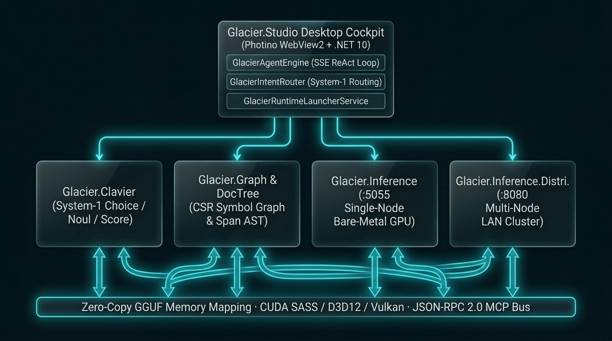
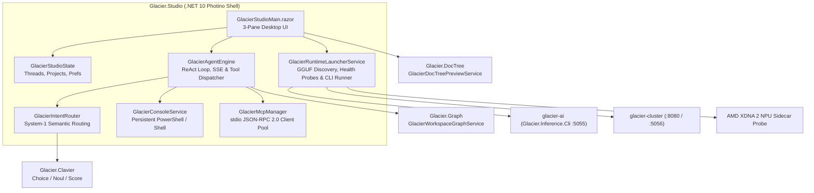

# Glacier.Studio Architecture

`Glacier.Studio` hosts a Blazor component UI (`GlacierStudioMain.razor`) inside a Photino WebView2 desktop shell, calling Glacier compute, graph, document-AST, and intent-routing libraries in process with no local proxy daemon.

## 1. Component Topology

## 2. Core Services & Responsibilities

- **`GlacierAgentEngine`:** Drives streaming `text/event-stream` chat completions, separates `<think>...</think>` blocks into collapsible trace sections, parses both native OpenAI `tool_calls` payloads and fallback `<tool_call>` JSON / direct function calls, enforces workspace-root bounds on file operations (`TryResolveWorkspacePath`), and applies rolling tool-output compaction to keep local KV-cache prefill fast.
- **`GlacierIntentRouter` (`Glacier.Clavier`):** Scores incoming prompts against semantic intent prototypes (`GeneralInquiry`, `ArchitectureReview`, `CodeSearch`, `ImplementationAndEdit`, `BuildAndTest`, `Debugging`, `DocumentationAndSpecs`) without regex keyword lists, generating step guidance and path-resolution recovery hints (`[CLAVIER SUPERVISOR RECOVERY]`) if a tool targets a missing file.
- **`GlacierWorkspaceGraphService` (`Glacier.Graph` & `CSharpLexer`):** Scans `.csproj` project graphs and tokenizes C# declarations cleanly (ignoring comments and string literals) into a Forward-Star graph for `query_knowledge_graph` and `search_workspace`. Optional NPU semantic embedding lookup falls back cleanly to deterministic hashing when the sidecar is offline.
- **`GlacierDocTreePreviewService` (`Glacier.DocTree`):** Parses open Markdown or code files into heading outlines with 1-based line offsets, live word counts, and approximate token budgets.
- **`GlacierRuntimeLauncherService`:** Detects discrete GPU VRAM via `DeviceManager.GetDevices()` (`StandaloneVramBudgetGb = 75%` of discrete VRAM or `4.8 GB` fallback), ranks discovered `.gguf` files, launches `glacier-ai` (`Glacier.Inference.Cli`) or `glacier-cluster`, manages a circuit breaker across local and remote cluster endpoints, and probes `/v1/models`, `/api/sleep/status`, `/v1/cluster/status`, and NPU sidecars in the background.
- **`GlacierMcpManager` & `GlacierMcpClient`:** Reads `~/.gemini/config/mcp_config.json`, lazily spawns stdio JSON-RPC 2.0 child processes, discovers tool schemas via `tools/list`, filters `disabledTools`, and routes `call_mcp_tool` invocations.
- **Security & AOT Serialization:** `StudioSecretProtector` encrypts stored keys with Windows DPAPI (`CryptProtectData` with `CRYPTPROTECT_UI_FORBIDDEN`) on Windows or AES-256-GCM (`"GST\x02"`) backed by a `0600` local key file on Unix. `StudioJsonContext` provides source-generated `System.Text.Json` serialization for preferences, OpenAI payloads, and MCP frames.
